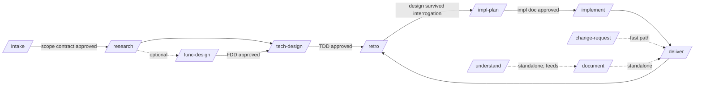

# Software Engineer Stack

A **GitHub Copilot** plugin covering the full software engineering lifecycle for codebases spanning **PL/SQL, SQL, KSH, and Python**. It turns a solution design document or requirement brief into researched, designed, implemented, verified, and packaged deliverables — while staying **accurate, fault-tolerant, self-improving, and scope-disciplined**.

## The lifecycle



| Command | What it does | Gate |
|---|---|---|
| `/intake <brief>` | Parse a solution design / requirement brief into a requirements summary and a **scope contract** | User approves scope contract |
| `/research` | Investigate the codebase and external sources; every finding carries a source reference | Checklist |
| `/func-design <task-id> \| brief <path> \| as-built <component> \| change <repo> <base>..<head>` | Optional functional design document for stakeholders: what the system does, when, and under which business rules — component logic as plain-language steps, tables/columns only where they carry meaning, no code (linted by `fdd_lint.py`). Forward (a proposed change; `/tech-design` then realises it), as-built (existing functionality), or change (a change already built, before vs after from its diff). Rendered for `audience=business` (default) or `technical` by `fdd_view.py` | User approves FDD |
| `/tech-design` | Produce a technical design document traceable to requirements and research | User approves TDD |
| `/grill` | Adversarial interrogation of the TDD: concrete edge-case scenarios per category (data, lifecycle, interface, temporal, environment, security/ops, deploy/rollback); gaps fixed from evidence, the rest grilled out of you until answered or explicitly deferred | Zero open questions |
| `/impl-plan` | Produce an implementation document: ordered steps, test plan, rollback plan | User approves impl doc |
| `/implement` | Execute the impl doc step by step on a branch, verifying each step | Code review + verification evidence |
| `/deliver` | Scope audit, evidence bundle, release notes, Word/PDF/Confluence conversion | Scope auditor passes |
| `/change-request <desc>` | Fast path for small changes: impact analysis → mini scope contract → change → verify → deliver | Inline approvals |
| `/understand <interface>` | Build a code-verified working understanding of any existing interface or integration: trace it end-to-end, map dependencies both directions, explain it in layers, answer follow-ups from the code | — |
| `/document <type> <target>` | Produce a how-to, KB article, or understanding document for an existing interface | Fact-checker passes |
| `/verify-code <files>` | Run per-language verification (live DB/host where available, static fallback) | — |
| `/retro` | Capture lessons from a finished task into the framework's knowledge base | User approves framework edits |

## Installation

The framework is a **GitHub Copilot plugin**: one install serves both the Copilot CLI and VS Code's Copilot harness. Setup is once per machine; nothing goes into your work repos.

### One-time setup

1. **Prerequisites:** `python3` (3.9+), `git`, a POSIX shell (macOS or Linux), and the GitHub Copilot CLI or VS Code with GitHub Copilot. Optional: `pandoc` to convert documents to Word/PDF/Confluence; `sqlplus` or SQLcl for live SQL and PL/SQL verification.
2. **Install the plugin:**
   ```sh
   copilot plugin marketplace add Loneranger001/software_engineer_stack
   copilot plugin install software-engineer-stack@se-stack
   ```
   **VS Code:** turn on the `chat.plugins.enabled` setting. Plugins installed with the CLI live in `~/.copilot/installed-plugins/` and then appear under Extensions → **Agent Plugins - Installed**. Or run the same two commands as `/plugin marketplace add …` and `/plugin install …` in a Copilot chat.
3. **Check it:** `copilot skill list` shows the 14 plugin skills, and `/agent` in a session lists the three reviewers (`scope-auditor`, `code-reviewer`, `doc-fact-checker`).
4. **Optional — `ses` in your own terminal.** Skills don't need it: Copilot doesn't put plugin executables on PATH, so each skill runs `bin/ses` from its own plugin folder. It's handy for inspecting a task by hand:
   ```sh
   ln -s ~/.copilot/installed-plugins/se-stack/software-engineer-stack/bin/ses ~/.local/bin/ses
   ```
5. **Optional — environment variables.** Put them in your shell profile (`~/.zshrc`, `~/.bashrc`) so every session sees the same values, then restart Copilot / VS Code:
   ```sh
   export SES_DB_CONN='scott@//devdb:1521/DEVPDB'   # live SQL/PL/SQL verification (password via wallet or prompt)
   export SES_KSH_HOST='devuser@unixdev01'          # run KSH scripts over ssh
   export SES_PY="$HOME/.venvs/proj/bin/python"     # the work repo's Python interpreter
   export SES_WORKSPACE_ROOT="$HOME/ses-work"       # only to move task workspaces; the directory must exist
   ```
   Without the verification variables, `/verify-code` falls back to static checks and says so ([details](#environment-configuration-for-live-verification)). Leave `SES_WORKSPACE_ROOT` unset unless you want workspaces somewhere other than the folder holding your repos ([where workspaces go](#task-workspaces)).

That's it — nothing per work repo. Nothing is copied into your repos, and task workspaces are kept out of git automatically ([details](#keeping-work-out-of-git)). Open Copilot in the repo you're changing — or in the folder holding several repos — and start with `/intake`, `/change-request`, `/understand`, … New here? Read the [narrated walkthrough](docs/walkthrough.md).

### After setup

**Updating:** `copilot plugin update software-engineer-stack` (in VS Code: the Agent Plugins view, or `/plugin update`).

**Working on the framework itself:** install from your clone instead — `copilot plugin marketplace add ~/src/software_engineer_stack`, then the same install command — and turn on the checks once per clone with `git config core.hooksPath .githooks`. Copilot then loads the plugin live from the clone, so edits apply from the next session with no update step (VS Code doesn't see such local installs; use the CLI while developing).

**Cloud agents** (Copilot coding agent) check out only the repo and start fresh each time: the workspace is created inside the repo (and kept out of git), but it doesn't outlive the session — run lifecycle tasks locally.

**Claude Code and Codex** packaging is parked, not deleted: the skills are harness-neutral, and [parked/README.md](parked/README.md) has the steps to revive either.

## Task workspaces

Every engagement (task, change request, doc request) lives in its own workspace directory, `work/<task-id>/`, created by `/intake` (or `ses new-task`):

```
work/PROJ-123/                 (never committed — see "Keeping work/ out of git")
├── STATUS.md                  # minimal: repos, one line per stage gate, next action
├── brief.md                   # the requirement brief as received
├── scope-contract.md          # /intake — approved scope, the single source of scope truth
├── research-notes.md          # /research
├── fdd.md                     # /func-design (optional), plus fdd.<audience>.md views
├── tdd.md                     # /tech-design
├── grill-log.md               # /grill — every scenario confronted and its verdict
├── impl-doc.md                # /impl-plan
├── evidence/                  # captured run outputs (summaries; raw logs in evidence/raw/)
├── release-notes.md           # /deliver
├── deliverables/              # converted docx / pdf / Confluence outputs
├── ASSUMPTIONS.md             # proceed-and-log decisions awaiting gate ratification
└── PARKED.md                  # out-of-scope findings logged, never acted on
```

A change request keeps `analysis.md` (impact analysis + mini contract) instead of the contract/TDD/impl doc; `/understand` keeps `interface-map.md`; `/document` keeps the document it writes.

**Who keeps which state.** The harness owns the *session*: conversation history, its own resume (`copilot --resume`, or reopening the chat session in VS Code), compaction, and in-session progress (todo/plan tools). The workspace owns the *task*: what was approved and when, what is in scope, what was assumed, what was built and proven. Nothing about the task lives only in chat, and nothing git or a stage document already records is duplicated into `STATUS.md` — it has no log and no step counter. A task started in the CLI resumes in VS Code, and vice versa.

`STATUS.md` is a dozen lines you can read at a glance:

```
# STATUS — DEMO-1
- task-id: DEMO-1
- pipeline: full
- work-repo: /home/you/workspace/sample-repo
- workspace-root: /home/you/workspace
- repos-analyzed: /home/you/workspace/sample-repo
- branch.sample-repo: feature/DEMO-1          (added by /implement)

## Stage gates
intake: approved (2026-07-11; by you, contract v1)
research: done (2026-07-11)
tech-design: pending
…
## Next action
Run /tech-design.
```

Skills never judge a gate by reading it themselves — they call `ses status`, which exits non-zero when a gate isn't met and rewrites the file atomically, stamping each transition with its date and note:

```sh
ses status require work/PROJ-123 impl-plan=approved          # exit 3 = gate not met, stop
ses status set     work/PROJ-123 intake=approved --note "by asif, contract v1" --next "Run /research."
ses status field   work/PROJ-123 branch.repo-a feature/PROJ-123
ses status show    work/PROJ-123
ses status validate work/PROJ-123                            # structure + skipped-gate check
```

States are `pending | in-progress | done | approved | waived` (a waiver carries who/why as free text after the state).

**Step record and evidence live in git.** Each `/implement` step is one checkpoint commit `<task-id> step <N>: …` ending with `Evidence-SHA256: <hash> <path>` lines (`ses checkpoint trailer`). On resume, `ses checkpoint resume` reports the last checkpoint step, branch mismatches, and every uncommitted file (the next step's own files vs anything unexpected), so a half-done step is kept or discarded by your choice, never folded silently into the next commit. `ses checkpoint verify` — run by the scope auditor at `/deliver` — fails if any recorded evidence file is missing or was edited afterwards.

**Handoff summaries — the context management.** The scope contract, research notes, FDD (when there is one), TDD and impl doc each open with a bounded summary (≤ 40 lines, one line per ID) between `<!-- handoff:start -->` / `<!-- handoff:end -->`, written last at that stage's gate. Later stages read the summary (`ses handoff show <doc>`) and open full sections only when they need the detail — except where judging the whole document is the job: `/tech-design` on the contract, `/grill` and `/impl-plan` on the TDD, the scope auditor on everything. `ses handoff check <ws>` fails a summary that is missing an ID the body defines (S#, N#, A#, Q#, T#, numbered steps), runs over length, or names an older contract version than `scope-contract.md`. This works the same in every harness and survives any harness's compaction, because it is on disk.

### Keeping `work/` out of git

Task workspaces never reach a repository or its remote — no setup needed:

- **Multi-repo workspace:** `work/` sits in the folder holding the repos, outside all of them.
- **Standalone repo:** `work/` sits inside the repo, and `ses new-task` adds `/work/` to that clone's `.git/info/exclude` — a local ignore list that is never committed or pushed, so your team's `.gitignore` stays untouched. An existing `.gitignore` entry of your own works just as well; if `work/` is already tracked, `ses new-task` warns you.
- **Commits** stage the step's own files by name, never `git add -A`; `ses checkpoint trailer` refuses to produce a commit's evidence lines while any workspace file is staged.
- **Before anything is pushed,** the `/deliver` scope audit runs `ses checkpoint verify`, which fails if any workspace file is on a task branch — and `/deliver` pushes only the task branches.

What does go into git is a hash: each checkpoint commit message ends with `Evidence-SHA256: <hash> evidence/<file>` lines, which prove later that the evidence wasn't altered — file names and hashes, never the content.

To move a workspace, move the directory and run `ses status field <ws> workspace-root <new-root>`; `SES_WORKSPACE_ROOT` pins where new ones go.

### Which repo is "the repo"

Two paths every stage resolves before touching anything, per [core/repo-resolution.md](core/repo-resolution.md): **`<work-repo>`** (the directory holding `.git` and its own rules files) and **`<workspace-root>`** (the directory holding `work/` — task workspaces and the one domain glossary — the folder holding the repos in a multi-repo workspace, else the repo). Both are recorded absolutised in `STATUS.md` at scaffold time, and later stages read them from there rather than re-deriving from their own working directory.

This matters when your editor workspace is a **parent folder containing several repos** — a supported layout, and the one case where the session's current directory is not a repo at all. There, `work/` lives in that parent folder, each repo's own rules files apply to code in that repo (rules are a property of a repo, not of the workspace), stages address repo-level paths with the `<work-repo>/` prefix, and a stage with no `STATUS.md` to read will ask which repo the task is about instead of guessing. See [Q&A #21](docs/QA.md).

### Each repo's own rules files

Stages follow the rules a repo's team already wrote instead of a framework-generated cache. `ses repo-rules <repo> [changed files]` lists them: `AGENTS.md`, `CLAUDE.md`, `CODING_STANDARDS.md`, `STANDARDS.md`, `STYLEGUIDE.md`, `CONVENTIONS.md`, `CONTRIBUTING.md` (case-insensitive, at the root or under `docs/`), `.github/copilot-instructions.md` and `.github/instructions/*.instructions.md`, plus nested `AGENTS.md`/`CLAUDE.md` above each changed file. It also lists tooling configs (`pyproject.toml`, `.shellcheckrc`, `.pre-commit-config.yaml`, …) for `/verify-code` to run. Adapter files generated by framework versions up to 0.6 are skipped.

Precedence: nested `AGENTS.md` nearest the file > the repo's root rules > the surrounding file's style (for what the rules leave open) > framework `standards/`. Untouched lines are never restyled to satisfy a rule, and two rules files that contradict each other are raised as a question. The framework never edits a repo's rules files; `/retro` proposes additions for you to commit.

### Analysis spans every repo; writing doesn't

Repos share a workspace because they talk to each other, so a task's **analysis** scope is wider than its **write** scope:

- **`<repo-set>`** — every repo under the workspace folder (enumerated by `ses list-repos`, recorded in `STATUS.md`). Impact analysis, caller/dependent searches, call graphs, and dependency maps run across ALL of them. A repo searched with no hits is reported as *searched, no references found*, with the command — because a repo nobody searched and a repo with no callers produce the same silence. References are qualified `<repo>:<path>:<line>`.
- **`<changed-repos>`** — the subset the scope contract says may be modified. It starts as the primary repo and grows only with the user's approval at a gate. Each changed repo gets its own branch and follows its own rules files; the impl doc names a repo per step and states the cross-repo deploy order.

Searches go through `ses search --ws <ws> [--ref origin/<mainline>] -- <patterns>`: one command per repo, counts and top files first (full per-file list with `--save`), and ready-made rows for the research notes' search record, each carrying the commit searched — so a later stage reuses a row while that repo hasn't moved and re-searches only the repos that have. Reviews go through `ses review-diff <repo> <mainline> <branch>`: a `--stat`-style plan first, then one file at a time with `--file`, with workspace, evidence, framework-generated and lockfiles listed but not read.

Excluding a repo from analysis is a user decision recorded in the contract, never an inference from a repo looking unrelated. See [Q&A #22](docs/QA.md).

## The four guarantees

- **Accurate** — every factual claim in a generated document must carry a source reference (`file:line`, doc section, or captured run output). Code is verified by running it (`/verify-code`), the `doc-fact-checker` agent re-verifies documents against the code before a stage closes, and `/grill` attacks the design's *completeness* — the edge cases nobody wrote down — before implementation is planned.
- **Fault-tolerant** — stages are idempotent and resumable from the workspace on disk, in any harness; gates are checked by `ses status`, never by eye; implementation happens on a branch with evidence-hashed checkpoint commits; every impl doc has a rollback section.
- **Self-improving** — `/retro` appends structured lessons to your `~/.ses/lessons.md` (outside every install, shared by every harness); every skill loads only the lessons matching its stage/language/repo — yours plus the framework's `knowledge/lessons.md` — through `ses lessons` before starting. Retro can also propose edits to templates/checklists, applied only with your approval. The workspace additionally accumulates one `work/domain-glossary.md` — global business terms only, each one functional statement true in every repo ("Order means purchase order; it exists in ORDHEAD (header) and ORDSKU (detail).") — so a term explained once is never re-asked. A meaning that varies by repo stays out; the task that needs it defines it per repo. Like the task workspaces beside it, the glossary never goes into git.
- **Scope-disciplined** — `/intake` produces a scope contract you approve; every later skill re-reads it. Anything discovered out of scope goes to `PARKED.md`, never into the change. The `scope-auditor` agent gates `/deliver`.

## When the agent doesn't know

Every skill follows the shared [decision protocol](core/decision-protocol.md).
The short version:

1. **Checkable facts get checked** — if reading code or running a query can
   answer it, that happens; confidence estimates are reserved for genuine
   judgment calls.
2. **Proceed + log** (no interruption) only when the call is ~90%+ confident
   AND cheaply reversible AND inside the scope contract AND touches nothing
   dangerous (data changes, external contracts, prod). The assumption is
   recorded in the workspace's `ASSUMPTIONS.md` with its basis, impact-if-wrong,
   and reversal step.
3. **Stop and ask** for everything else — genuinely unknown, irreversible or
   high blast-radius (regardless of confidence), scope-affecting, or
   user-reserved. Blocking questions ask immediately; the rest batch at stage
   boundaries.
4. **Every approval gate ratifies open assumptions** — you see what was
   assumed before you sign off, and nothing is delivered on an unratified
   guess (the scope auditor enforces it).
5. `/retro` reviews corrected assumptions as calibration feedback, so
   over-confidence turns into lessons.

## Environment configuration for live verification

Connection details are **never stored in this framework**. Verification recipes read them from the environment of the machine Copilot runs on:

| Variable | Used for | Example |
|---|---|---|
| `SES_DB_CONN` | `sqlplus`/`sql` (SQLcl) connect string for the dev schema | `scott@//devdb:1521/DEVPDB` (password via wallet or prompt) |
| `SES_KSH_HOST` | Optional ssh host for running KSH scripts | `devuser@unixdev01` |
| `SES_PY` | Python interpreter for the work repo | `~/.venvs/proj/bin/python` |

If a variable is unset or the environment is unreachable, `/verify-code` falls back to static checks and says so in the evidence file.

One more variable, not for verification: `SES_WORKSPACE_ROOT` (an existing directory, e.g. `~/ses-work`) pins where `ses new-task` puts every new `work/<task-id>/`, overriding the folder-holding-the-repos / the-repo rule. Nothing sets it for you — export it in your shell profile so every session sees the same value: a later session that resolves a different root looks for its tasks in the wrong place. `ses new-task` prints the root it used and where it came from, and stops for your decision (exit 3) when the task id already has a workspace for another repo or pipeline, or under the old root.

## Repository layout

```
bin/ses       the one command skills use: dispatches to scripts/, prints the root
skills/       one directory per lifecycle command (SKILL.md each) — harness-neutral
templates/    canonical Markdown templates for every document type
core/         decision-protocol.md (what to do when unknown), repo-resolution.md (where the files are —
              the rules card skills load; repo-resolution-rationale.md holds the why)
standards/    default coding standards per language (a repo's own rules files override them)
checklists/   per-stage quality gates
knowledge/    lessons.md (shipped lessons; yours go to ~/.ses/lessons.md), decisions.md (framework decision log)
docs/         QA.md (design Q&A + testing guide), walkthrough.md (narrated example task)
scripts/      what `ses` runs: status.py (gates), new-task.sh, list-repos.sh, workspace-root.sh,
              repo-rules.sh, handoff.py, checkpoint.py, xsearch.py, review-diff.sh, lessons.sh,
              capture.sh, fdd_lint.py, fdd_view.py, md2docx.sh, md2pdf.sh, md2confluence.sh;
              check_knowledge.py (maintenance)
tests/        unittest suite for ses, the scripts, and the skill wiring (run by CI and the pre-commit hook)
examples/     sample work repo + a worked example task workspace
plugin.json         the Copilot plugin manifest (Agent Plugins 1.0)
.github/plugin/marketplace.json   the marketplace `copilot plugin marketplace add` reads
com.github.copilot/agents/        scope-auditor, code-reviewer, doc-fact-checker — read-only reviewer agents
parked/             Claude Code and Codex packaging, inactive (parked/README.md: how to revive)
```

## Maintaining the framework

Edit the canonical files — there is nothing generated to regenerate. When releasing, bump `version` in `plugin.json`; installed plugins show an update when it changes. Checks, in CI (`.github/workflows/framework-checks.yml`) and locally via the pre-commit hook (`git config core.hooksPath .githooks`, once per clone):

- `python3 -m unittest discover -s tests` — includes `tests/test_skill_flow.py`, which fails on any instruction file that names a harness-specific path (`${CLAUDE_PLUGIN_ROOT}`) or a raw script path instead of `ses <command>`, references a `ses` command or `<root>/` file that doesn't exist, or breaks the stage wiring.
- `python3 scripts/check_knowledge.py` — fails if a `knowledge/decisions.md` "Applied changes" entry names a file that has no commit on or after the entry's date (an edit recorded as applied but lost), or if a lesson line doesn't match the tag format skills filter on.
- `tests/test_plugin_manifests.py` checks the Copilot manifest, marketplace and reviewer agents (and that the parked packaging stays valid but inactive).

`/retro` follows the same rule: framework edits go into your checkout, never into an installed copy (a plugin cache is replaced on update); lessons go to `~/.ses/lessons.md`.

## Document conversion

Deliverables are authored in Markdown and converted on `/deliver`:

```sh
ses md2docx work/PROJ-123/tdd.md          # → deliverables/tdd.docx
ses md2pdf  work/PROJ-123/tdd.md          # → deliverables/tdd.pdf
ses md2confluence work/PROJ-123/tdd.md    # → deliverables/tdd.confluence.txt
```

The scripts require [pandoc](https://pandoc.org) (and a LaTeX engine for PDF); they print install instructions if it's missing.
