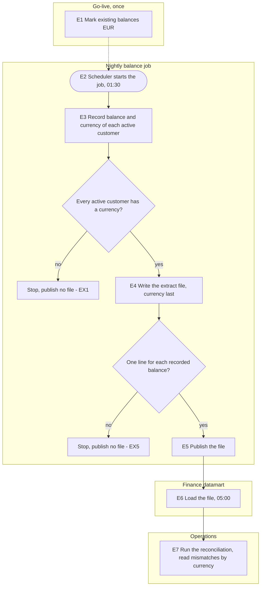

# Functional Design Document — DEMO-1: Balance extract currency support

- Status: draft, for approval (one open question, Q4)
- Mode: forward (proposed change)
- Inputs: scope-contract.md v1 + research-notes.md
- Audience: Finance (business owner), Operations, the datamart team, UAT testers, developers
- Author: Claude, reviewed by {you}

## 1. Why this change and what it does

### 1.1 Why

Finance is adding UK customers, whose balances are in pounds sterling (GBP).
Today, the nightly balance extract does not record a currency. Every amount
in the balance snapshots and in the extract file is taken to be in euros
(EUR). After UK customers go live, the datamart and the reconciliation would
read a GBP balance as an EUR balance.

Operations asked for the change in change request CHG-2214. Delivery is
due at the end of the month.

### 1.2 What changes and why

#### C1. Every balance recorded before go-live is marked as euros

- Today: a balance snapshot holds the customer, the date and the balance,
  but no currency.
- After this change: at go-live, every existing snapshot gets the currency
  EUR, one time.
- Why: every balance recorded before this change is in euros (CHG-2214).
  The history is marked one time, so that every program reads the same
  currency from the data. The other way was to leave the history empty and
  treat empty as EUR. Every program that reads the history would then need
  that rule (decision: Operations, 2026-07-11).
- Who notices: anyone who reports on past balances sees EUR beside them.
- Where it happens: once, at go-live (E1, §4.1). Requirement: FR1.

#### C2. Each night's balances carry the customer's currency

- Today: the nightly run records each active customer's balance, with no
  currency.
- After this change: each balance also holds the customer's currency, for
  example GBP or EUR, from the customer record.
- Why: the datamart and the reconciliation must know the currency of each
  balance. The customer record already holds each customer's currency
  (Q1), so no new data is needed.
- Who notices: no one directly. The extract file and the reconciliation
  use it (C4, C5).
- Where it happens: the nightly run (E3, §4.3 step 4). Requirement: FR2.

#### C3. The nightly run stops if an active customer has no currency

- Today: every active customer gets a balance, whatever the customer record
  holds.
- After this change: if any active customer has no currency, the night's
  run stops. No file is published that night.
- Why: a balance without a currency could be read as the wrong currency.
  The run stops so that the gap is seen and fixed the same morning
  (decision: Operations, 2026-07-11).
- Who notices: Operations, who see the failed job, and the datamart team,
  who get no file that night.
- Where it happens: the nightly run (E3, §4.3 step 5). Requirement: FR3.

#### C4. The extract file gains a fourth field: the currency

- Today: each line holds the customer number, the snapshot date and the
  balance.
- After this change: each line also holds the currency, as a fourth field
  at the end. The first three fields do not change.
- Why: the datamart needs the currency to report UK balances correctly.
  The new field goes at the end because the datamart load ignores fields
  after the third. So the current load keeps working, with no change on
  the datamart side (Q2).
- Who notices: the datamart team. Their load is unchanged until they decide
  to read the new field, which is a separate change on their side.
- Where it happens: the nightly run (E4, §4.2 step 3). Requirement: FR4.

#### C5. The reconciliation groups mismatches by currency

- Today: the reconciliation lists every customer whose balance differs
  between the extract file and the datamart, in one list, with no currency.
- After this change: it groups the list by currency and shows the currency
  on each line. It reads a file from before go-live as euros.
- Why: amounts in different currencies cannot be compared or added, so a
  mismatch must say which currency it is in (CHG-2214). Files from before
  go-live hold only euros (CHG-2214).
- Who notices: Operations, who run the reconciliation each morning (Q5).
- Where it happens: the morning reconciliation (E7, §4.4 step 5).
  Requirement: FR5.

### 1.3 Decisions needed

Finance must confirm that every transaction of a UK customer is in pounds
(Q4). The balance adds up a customer's transactions and does not convert
any amount. If a UK customer has a transaction in euros, that customer's
balance is wrong.

### 1.4 Business terms

| Term | Meaning |
|---|---|
| Active customer | A customer whose status is active (`CUSTOMERS.STATUS` = 'ACTIVE'). Only active customers get a balance. |
| Balance snapshot | One customer's balance at the end of one business day, kept in BALANCE_SNAPSHOT. |
| Extract file | The nightly file of balance snapshots that the finance datamart loads. |
| Datamart | The finance reporting database, which loads the extract file each morning. |
| Currency code | The three-letter ISO 4217 code of a currency, for example EUR (euro) or GBP (pound sterling). |

## 2. Scope

### 2.1 Functional requirements

| # | Requirement (what the system must do) | Source |
|---|---|---|
| FR1 | At go-live, mark every existing balance snapshot as EUR | S1 |
| FR2 | Record each active customer's currency with the customer's balance every night | S2 |
| FR3 | Stop the nightly run, and publish no file, when an active customer has no currency | S2, Q3 |
| FR4 | Add the currency to each extract file line as a fourth field, after the existing three | S3 |
| FR5 | Group reconciliation mismatches by currency, and read a three-field line as EUR | S4 |

### 2.2 Out of scope

- Converting amounts between currencies. The design carries each currency
  and does not use exchange rates (N1).
- Any change to when the nightly job runs or how it is started (N2).
- Any change to the datamart load. The datamart team owns it (N3).

## 3. Sequence of events

The process starts when the scheduler starts the nightly job, and ends when
Operations read the reconciliation the next morning. Go-live adds one step,
once, before the first night.

| # | When | What happens | Who or what does it | Detail |
|---|---|---|---|---|
| E1 | Once, at go-live, before the first nightly run | (new, C1) Every existing balance snapshot gets the currency EUR. | Go-live data update | §4.1 |
| E2 | 01:30 each night (Q5) | The scheduler starts the nightly balance job for today's date. | Scheduler | §4.2 steps 1–2 |
| E3 | After E2 | (changed, C2, C3) The job records each active customer's balance and currency for the day. | Nightly balance job | §4.3 |
| E4 | After E3 | (changed, C4) The job writes the extract file, with the currency as the fourth field. | Nightly balance job | §4.2 step 3, §7 |
| E5 | After E4 | The job checks that the file has one line for each recorded balance, and then publishes it. | Nightly balance job | §4.2 steps 4–5 |
| E6 | 05:00 (Q5) | The datamart loads the published file. Its load ignores the fourth field. | Finance datamart | outside this function, §7 |
| E7 | Each morning, after E6 (Q5) | (changed, C5) Operations run the reconciliation and read the mismatches, grouped by currency. | Reconciliation tool | §4.4, §9 |

## 4. Step by step

### 4.1 Go-live data update — new

- Purpose: marks every balance recorded before go-live as a euro balance.
- Starts when: once, during go-live, before the first nightly run with this
  change (E1).
- Hands over to: the nightly balance job. From its first run, every balance
  has a currency (E2, §4.2).
- Processing logic:
  1. (new, C1) Give every balance snapshot a currency
     (`BALANCE_SNAPSHOT.CURRENCY_CODE`, new).
  2. (new, C1) Set the currency of every existing balance to EUR (BR1).
  3. (new, C1) From then on, require a currency on every balance (BR2).
- Outputs and effects: every existing balance has
  `BALANCE_SNAPSHOT.CURRENCY_CODE` = 'EUR'.
- If something goes wrong: if the update stops part of the way through, the
  go-live team runs it again. It sets only balances that have no currency.
- Requirements met: FR1.

### 4.2 Nightly balance job (`run_balance_extract.ksh`) — changed

- Purpose: records the day's balances, then writes, checks and publishes the
  extract file for the datamart.
- Starts when: the scheduler starts it at 01:30 each night (E2, Q5).
  Operations can also start it for an earlier date, to run that day again.
- Hands over to: the balance snapshot, which records the balances (E3,
  §4.3). After it publishes the file, the datamart loads it (E6).
<!-- technical:start -->
- Inputs:

  | Input | Business meaning | Mandatory | Valid values / default |
  |---|---|---|---|
  | snapshot date | the business day to record | no | eight digits, year first; defaults to today |

<!-- technical:end -->
- Processing logic:
  1. Take the snapshot date given at the start, or today. An invalid date
     stops the job (EX4).
  2. Ask the balance snapshot to record the day's balances (§4.3). If that
     fails, stop and publish no file (EX3).
  3. (changed, C4) Write one line for each recorded balance, in customer
     number order, with the currency last (BR3, §7).
  4. Count the recorded balances again and compare the count with the lines
     in the file (BR4). If they differ, stop (EX5).
  5. Publish the file as `balance_<YYYYMMDD>.dat`. Until then it has a
     temporary name, so a partial file is never published.
- Outputs and effects: the published extract file (§7), and a start line and
  an end line in the job log. The end line shows the number of lines.
- If something goes wrong: an invalid date (EX4), a failed database step
  (EX3), or a count that does not match (EX5) stops the job. No file is
  published.
- Requirements met: FR4.

### 4.3 Balance snapshot (`pkg_balance.extract_daily`) — changed

- Purpose: records one balance for each active customer, for the snapshot
  date.
- Starts when: the nightly balance job asks for it (E3, §4.2 step 2).
- Hands over to: the nightly balance job, which writes the file from these
  balances (E4, §4.2 step 3).
- Processing logic:
  1. Remove any balances already recorded for the snapshot date, so that a
     run for the same date replaces them (BR5).
  2. Select every active customer (`CUSTOMERS.STATUS` = 'ACTIVE').
  3. Work out each customer's balance: the sum of their transactions up to
     the end of the snapshot date.
  4. (changed, C2) Record the balance with the customer's currency
     (`CUSTOMERS.CURRENCY_CODE`).
  5. (new, C3) If an active customer has no currency, record nothing for
     the date and stop (BR2, EX1).
  6. If there are no active customers, stop (EX2).
- Outputs and effects: one `BALANCE_SNAPSHOT` row for each active customer:
  the customer, the date, the balance and the currency. A customer with no
  transactions has a balance of zero.
- If something goes wrong: a customer with no currency (EX1) or no active
  customers (EX2) stops the run. The balances already recorded for the date
  stay as they were.
- Requirements met: FR2, FR3.

### 4.4 Reconciliation tool (`reconcile.py`) — changed

- Purpose: compares the balances in the extract file with the balances that
  the datamart loaded, and lists every difference.
- Starts when: Operations run it each morning after the datamart load, with
  the two files (E7, Q5).
- Hands over to: the person who runs it, who reads the report (§9). The
  process ends here.
- Processing logic:
  1. Read the extract file and the datamart file. An extract line with three
     fields is a euro balance (BR6).
  2. If a file or a line cannot be read, stop and name the file and the line
     (EX6).
  3. Compare each customer's balance in the two files.
  4. List each customer whose balances differ, who is missing from the
     datamart, or who is only in the datamart (BR7).
  5. (changed, C5) Group the list by currency, and show the currency on each
     line (BR7).
  6. Show the number of customers checked and the number of mismatches for
     each currency.
  7. If there is a mismatch, end with a failed status.
- Outputs and effects: the reconciliation report (§9). Nothing is changed.
- If something goes wrong: a file or a line that cannot be read stops the
  tool (EX6).
- Requirements met: FR5.

## 5. Business rules and validations

| # | Rule | Applies to | When violated |
|---|---|---|---|
| BR1 | Every balance recorded before go-live is a euro balance. | §4.1 step 2 | not applicable: set once, at go-live |
| BR2 | Every balance has a currency, taken from the customer record. | §4.1 step 3, §4.3 step 5 | the nightly run stops (EX1) |
| BR3 | The currency is the fourth and last field of each extract line. The first three fields keep their order and meaning. | §4.2 step 3 | the datamart load would read the file wrongly |
| BR4 | The job publishes the file only if it has one line for each recorded balance. | §4.2 step 4 | the file is not published (EX5) |
| BR5 | A run for a date replaces the balances already recorded for that date. It never adds a second set. | §4.3 step 1 | not applicable |
| BR6 | An extract line with three fields, from before go-live, is a euro balance. | §4.4 step 1 | not applicable |
| BR7 | A mismatch takes its currency from the extract file. The datamart file holds no currency. | §4.4 steps 4–5 | not applicable |

Decision table — BR7, one row for each customer the reconciliation sees:

| In the extract file | In the datamart file | Balances equal | Listed as | Currency shown |
|---|---|---|---|---|
| yes | yes | yes | not listed | none |
| yes | yes | no | balance differs | from the extract file |
| yes | no | not applicable | missing from the datamart | from the extract file |
| no | yes | not applicable | only in the datamart | "currency not known" |

## 6. Data

### 6.1 Data elements

| Entity (table / file / message) | Attribute | Business meaning | Usage | New / existing |
|---|---|---|---|---|
| BALANCE_SNAPSHOT | SNAPSHOT_DATE | the business day that the balance is for | create, remove on a rerun | existing |
| BALANCE_SNAPSHOT | CUSTOMER_ID | the customer | create | existing |
| BALANCE_SNAPSHOT | BALANCE_AMT | the customer's balance at the end of the day, with 2 decimal places, in the row's currency | create | existing |
| BALANCE_SNAPSHOT | CURRENCY_CODE | the currency of the balance, as a currency code | create; set to EUR once at go-live | new |
| CUSTOMERS | STATUS | whether the customer is active | read | existing |
| CUSTOMERS | CURRENCY_CODE | the customer's currency | read | existing |
| TRANSACTIONS | AMOUNT, TXN_DATE | the amount and date of each transaction; the balance is their sum up to the snapshot date | read | existing |

### 6.2 Status and code values

| Attribute | Value | Meaning | Set by |
|---|---|---|---|
| CUSTOMERS.STATUS | ACTIVE | the customer is active and gets a balance each night | customer administration, outside this function |
| BALANCE_SNAPSHOT.CURRENCY_CODE | EUR | euro: every balance from before go-live, and every euro customer | the go-live update (§4.1), then the customer record |
| BALANCE_SNAPSHOT.CURRENCY_CODE | GBP | pound sterling: UK customers | the customer record |

## 7. Interfaces

| Direction | Counterpart | What is exchanged (business content) | File / message | Frequency |
|---|---|---|---|---|
| outbound | Finance datamart | one line for each active customer: customer number, snapshot date, balance and (new) currency | `balance_<YYYYMMDD>.dat` in the extract folder | nightly, at E5 |
| inbound | Finance datamart | the balances that the datamart loaded: customer number, snapshot date, balance | the datamart file given to the reconciliation | each morning, at E7 |

Each extract line holds four fields, separated by a vertical bar (`|`):

1. Customer number (`BALANCE_SNAPSHOT.CUSTOMER_ID`).
2. Snapshot date (`BALANCE_SNAPSHOT.SNAPSHOT_DATE`).
3. Balance (`BALANCE_SNAPSHOT.BALANCE_AMT`).
4. (new, C4) Currency code (`BALANCE_SNAPSHOT.CURRENCY_CODE`).

The datamart load ignores the fourth field today (Q2). To read it is a
change on the datamart side.

## 8. Exceptions and error handling

| # | Situation | Happens at | System behaviour | Who is informed, how | Business recovery |
|---|---|---|---|---|---|
| EX1 | An active customer has no currency (new, C3) | §4.3 step 5 (E3) | The job stops. The date's balances stay as they were, and no file is published. | Operations, through the failed job in the scheduler (Q5) | Add the currency to the customer record, then run the job again for that date. |
| EX2 | No active customers for the date | §4.3 step 6 (E3) | The job stops and names the date. No file is published. | Operations, through the failed job | Check the customer data, then run the job again. |
| EX3 | A database step fails for any other reason | §4.2 step 2 (E3) | The job stops. No file is published. | Operations, through the failed job | Fix the cause, then run the job again for that date. |
| EX4 | The snapshot date given at the start is not valid | §4.2 step 1 (E2) | The job stops at once. Nothing changes. | Operations, through the failed job | Start the job again with a valid date. |
| EX5 | The file does not have one line for each recorded balance | §4.2 step 4 (E5) | The job stops and shows both counts. The file is not published. | Operations, through the failed job | Run the job again for that date. |
| EX6 | The reconciliation cannot read a file or a line | §4.4 step 2 (E7) | The tool stops and names the file and the line. | The person who runs it | Correct or replace the file, then run the tool again. |

## 9. Reports, screens and notifications

The reconciliation report (E7) lists the mismatches, grouped by currency.
Each line names the customer, what is wrong, the balances where both files
have one, and the currency. The
report ends with the number of customers checked and the number of
mismatches for each currency.

The nightly job writes a start line and an end line to its log (E2, E5). The
end line shows the number of lines in the published file.

## 10. Security and access

No change. The job, the extract folder and the reconciliation keep their
current access. The extract file holds customer numbers, dates, balances and
currencies, but no names or addresses.

## 11. Operational expectations

- Volumes: about 50,000 active customers, so about 50,000 lines each night.
- Timing window and service level: the job must publish the file before the
  datamart load at 05:00 (Q5).
- Late or missing events: if no file is published by 05:00, the datamart
  load has no file for that day. What the datamart load does then belongs
  to the datamart team. The go-live update (E1) must be complete before
  01:30. If it is not, the first nightly run fails (EX3).
- Rerun behaviour: a run for a date replaces that date's balances and file
  (BR5). It never adds a second set.
- Audit and retention: no change.

## 12. Dependencies and open questions

Dependencies: the datamart load ignores fields after the third (Q2). Every
active customer has a currency in the customer record (Q1).

| # | Question | Owner | Status |
|---|---|---|---|
| Q1 | Where does a customer's currency come from? | Finance | answered: the customer record, `CUSTOMERS.CURRENCY_CODE`, which is filled in for every customer |
| Q2 | Can the datamart load a file with a fourth field? | Datamart team | answered: yes, the load ignores fields after the third (decision: datamart team, 2026-07-11) |
| Q3 | What happens when an active customer has no currency? | Operations | answered: the nightly run stops, so the gap is seen and fixed (decision: Operations, 2026-07-11) |
| Q4 | Is every transaction of a UK customer in pounds? The balance adds up transactions and does not convert any amount. | Finance | open |
| Q5 | When does the job run, who watches it, and when does the datamart load the file? | Operations | answered: the scheduler starts the job at 01:30 and alerts Operations when it fails. The datamart loads the file at 05:00. Operations run the reconciliation each morning after the load (decision: Operations, 2026-07-12) |

## 13. Functional test scenarios

| # | Scenario | Given | When | Then | Covers |
|---|---|---|---|---|---|
| TS1 | Balances from before go-live | balances recorded before go-live | the go-live update runs | every existing balance has the currency EUR | FR1, A1 |
| TS2 | UK customer | an active customer with the currency GBP | the nightly run | the balance and the file line show GBP | FR2, FR4, A2 |
| TS3 | Euro customer | an active customer with the currency EUR | the nightly run | the balance and the file line show EUR | FR2, A2 |
| TS4 | Customer with no currency | an active customer whose currency is empty | the nightly run | the job fails, the date's balances stay as they were, and no file is published | FR3 |
| TS5 | New file layout | a completed nightly run | the datamart team loads a sample of the file | each line has four fields, currency last, and the load accepts it | FR4, A3 |
| TS6 | Mismatch in pounds | a GBP customer whose datamart balance differs | the reconciliation runs | the mismatch appears under GBP, and the tool ends with a failed status | FR5, A4 |
| TS7 | File from before go-live | an extract file with three fields on each line | the reconciliation runs | its balances count as EUR | FR5 |

## 14. Sign-off

| Role | Name | Date | Decision |
|---|---|---|---|
| Finance (business owner) | | | |
| Operations | | | |
| Datamart team | | | |

<!-- technical:start -->
## Appendix A. Source references

| Section | Claim | Source |
|---|---|---|
| §3 E2, §4.2 step 1 | the job runs for today's date unless a date is given | sample-repo:bin/run_balance_extract.ksh:9 |
| §3 E2, E6, E7, §11 | job at 01:30, datamart load at 05:00, reconciliation each morning | decision: Operations, 2026-07-12 (Q5) |
| §4.2 step 1, EX4 | a date that is not eight digits stops the job before any change | sample-repo:bin/run_balance_extract.ksh:10-13 |
| §4.2 step 2, EX3 | a failed database step stops the job; no file is published | sample-repo:bin/run_balance_extract.ksh:23-38 |
| §4.2 step 3 | one line for each recorded balance, customer number order, fields separated by a vertical bar | sample-repo:bin/run_balance_extract.ksh:28-31 |
| §4.2 steps 4–5, BR4, EX5 | count compared with the recorded balances; publish only on a match; temporary name until then | sample-repo:bin/run_balance_extract.ksh:18-19, 40-54; sample-repo:src/plsql/pkg_balance.pkb:33-40 |
| §4.2, §9 | start and end log lines; the end line shows the line count | sample-repo:bin/run_balance_extract.ksh:21, 56 |
| §4.3 step 1, BR5 | a run for a date first removes that date's balances | sample-repo:src/plsql/pkg_balance.pkb:7 |
| §4.3 steps 2–3 | active customers only; sum of transactions up to the end of the date; zero when there are none | sample-repo:src/plsql/pkg_balance.pkb:11-23 |
| §4.3 step 6, EX2 | no active customers stops the run and names the date | sample-repo:src/plsql/pkg_balance.pkb:25-29 |
| §4.3, EX1, EX2 | a failed run leaves the date's earlier balances as they were | sample-repo:src/plsql/pkg_balance.pks:9-12 |
| §4.4 steps 1–4, 7, EX6 | reconciliation reads both files, compares balances, lists differing, missing and datamart-only customers, fails on a mismatch, stops on an unreadable line | sample-repo:tools/reconcile.py:18-31, 34-45, 48-64 |
| §6.1 BALANCE_AMT | 2 decimal places | sample-repo:src/sql/balance_snapshot.sql:16 |
| §6.1, Q1 | CUSTOMERS.CURRENCY_CODE exists and is filled in | evidence/research-columns.txt |
| §7 | the datamart file holds customer number, date and balance | sample-repo:tools/reconcile.py:7 |
| §11 Volumes | about 50,000 active customers | evidence/research-volumes.txt |
<!-- technical:end -->

<!-- handoff:start -->
## Appendix B. Handoff summary
- Contract version: 1
- Purpose: carry a currency on every balance and extract line, so UK (GBP) customers can go live
- Changes: C1 history marked EUR once — one rule in the data; C2 nightly balance carries customer currency — datamart needs it; C3 run stops on a customer with no currency — never guess; C4 currency appended as 4th field — datamart load ignores it; C5 reconciliation by currency — amounts in different currencies cannot be compared
- Requirements: FR1 backfill EUR; FR2 record currency nightly; FR3 stop on missing currency; FR4 4th field; FR5 reconcile by currency
- Traceability: S1 → FR1; S2 → FR2, FR3; S3 → FR4; S4 → FR5
- Sequence: E1 go-live §4.1 → E2 scheduler 01:30 §4.2 → E3 snapshot §4.3 → E4 write file §4.2 → E5 check and publish §4.2 → E6 datamart 05:00 → E7 reconciliation §4.4 (§3)
- Components: §4.1 go-live data update — new — FR1; §4.2 run_balance_extract.ksh — changed — FR4; §4.3 pkg_balance.extract_daily — changed — FR2, FR3; §4.4 reconcile.py — changed — FR5
- Business rules: BR1 history is EUR; BR2 currency required; BR3 currency is last field; BR4 publish only on count match; BR5 rerun replaces; BR6 3-field line is EUR; BR7 mismatch currency from extract
- Data: BALANCE_SNAPSHOT.CURRENCY_CODE — create (new); CUSTOMERS.CURRENCY_CODE, STATUS — read; TRANSACTIONS — read (§6)
- Interfaces: outbound — datamart — balance_<YYYYMMDD>.dat gains currency; inbound — datamart file to reconciliation (§7)
- Exceptions: EX1 no currency; EX2 no active customers; EX3 database failure; EX4 invalid date; EX5 count mismatch; EX6 unreadable reconciliation input
- Scenarios: TS1 → FR1 (A1); TS2 → FR2, FR4 (A2); TS3 → FR2 (A2); TS4 → FR3; TS5 → FR4 (A3); TS6 → FR5 (A4); TS7 → FR5
- Open questions: Q4 open (UK transactions all in GBP?); Q1, Q2, Q3, Q5 answered
<!-- handoff:end -->
