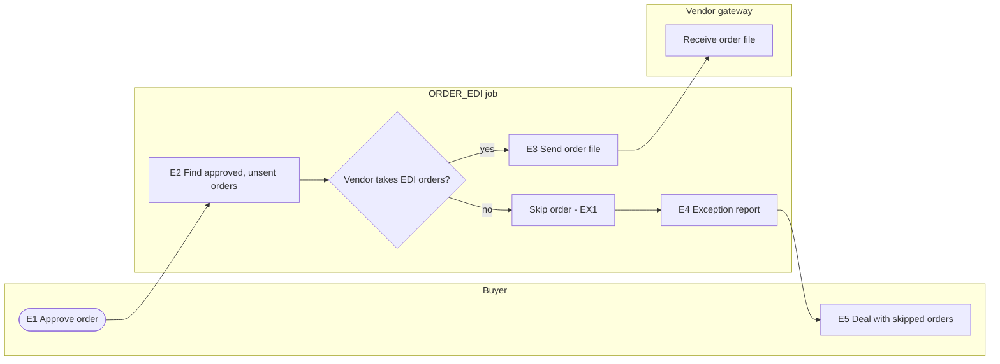

# Functional Design Document — {TASK_ID}: {TITLE}

- Status: draft | user-approved ({date})
- Mode: forward (proposed change) | as-built (existing behaviour) | change (a change already built)
- Inputs: {scope-contract.md v{n} + research-notes.md | brief: {path} | code: {repo}@{sha} | change: {repo} {base-sha}..{head-sha}}
- Audience: {who reads it: business owner, functional analysts, UAT testers, developers}
- Author: Claude, reviewed by {user}

<!-- FUNCTIONAL LEVEL ONLY (skills/func-design/SKILL.md, "Abstraction rules"):
     WHAT the system does, WHEN, under WHICH business rules, with WHAT effect
     on data — never HOW it is coded. Allowed: component names, table.column
     names that pin down business meaning, code values and their meaning,
     file names, numbered plain-language steps, decision tables, mermaid
     business flows. Not allowed: code, SQL, pseudocode, DDL, data types,
     indexes, hints, commit points, variable names, error codes.
     Mechanical floor: ses fdd-lint <file>.
     THE READER FOLLOWS THE RUN (SKILL.md, "Structure"): §1 says why and
     what changes; §3, the sequence of events, tells the run in time order
     and is the spine; §4 takes each component in that same order. §5–§11
     are reference: a reader looks things up there and never needs them to
     follow the run. A step says its rule and its failure in a few words
     with the ID, so the reader does not jump to §5 or §8 mid-step.
     ONE DOCUMENT FOR PEOPLE AND AGENTS: stakeholders read and approve it,
     and /tech-design, /grill and the reviewers work from it. Keep it
     complete and exact, and write every sentence in plain words and short
     sentences per <root>/standards/writing.md (check: ses prose-lint
     <file>). Say what the system does, never how the design was made: no
     research, task, scope contract, or stage names. Say the thing, then
     give its ID in brackets or in a column.
     This file is the one version people receive, converted as written. The
     handoff summary for later stages is Appendix B, at the end, so people
     start with §1. A business view (ses fdd-view) is rendered only on
     request: it drops Appendix B, every technical:start/end region, and
     Appendix A — keep the markers around developer-only detail. -->

## 1. Why this change and what it does

<!-- Lead with what the reader needs most. A reader who stops after §1
     knows why the change is made, what changes for them, and what they
     must decide. -->

### 1.1 Why

<!-- The business reason, in two short paragraphs at most: what goes wrong
     today or what the business needs, how often, who it affects, what it
     costs, and what happens if nothing changes. Name what started it: an
     incident, a request, a regulation, a date. Every reason comes from a
     source — the brief, the contract's objective, a recorded decision, the
     ticket or commit message that made the change, or the user. A reason
     that no source gives is a Q# asked of the user, never invented.
     As-built mode: title this "1.1 What it is for" — the business need the
     function serves, and who relies on it. -->
{Today, a purchase order waits for the weekly run before it goes to the
vendor. A vendor can start work on an order up to six days after the buyer
approves it, and late deliveries leave stores short of stock.}

{The buying team asked that each order reach its vendor on the day that
the buyer approves it (decision: Purchasing, {date}).}

### 1.2 What changes and why

<!-- Forward and change modes: one block per change that a stakeholder
     would notice, in the order that the changes happen in the run (§3).
     This is the most-read part of the document, so each line is concrete
     ("orders reach the vendor the same night", not "improved processing").
     "Why" gives the business reason for this change. Where a reader would
     expect it to work another way, it also says why it works this way.
     Every reason has a source, as in §1.1. Change mode fills "Today" from
     the base commit and "After this change" from the head commit.
     As-built mode: title this "1.2 What it does" and replace the blocks
     with one short paragraph. -->

#### C1. {Orders reach the vendor on the night that the buyer approves them}

- Today: {an approved order waits for the weekly run on Monday.}
- After this change: {the nightly run sends each order on the day that the
  buyer approves it.}
- Why: {a vendor can start work up to six days sooner. The run is nightly,
  not at the moment of approval, because the vendor gateway takes one file
  each day (decision: Purchasing, {date}).}
- Who notices: {buyers and vendors. A vendor gets one file each night
  instead of one each week.}
- Where it happens: {the nightly run (E2 and E3, §4.1). Requirement: FR1.}

### 1.3 Decisions needed

{The open questions that need an answer before approval, in a few words
each, with their ID (§12) — or "None".}

### 1.4 Business terms

<!-- One row per business term this document relies on, so it reads on its -->
<!-- own when handed over. A global term: its `Meaning` line copied VERBATIM -->
<!-- from <workspace-root>/work/domain-glossary.md, never paraphrased — the -->
<!-- doc-fact-checker flags a row that differs. A term the glossary leaves -->
<!-- out because its meaning differs by repo: define it here for the repo -->
<!-- this document concerns, from the research notes, naming the repo. -->

| Term | Meaning |
|---|---|
| {Order} | {Order means purchase order; it exists in ORDHEAD (header) and ORDSKU (detail).} |
| {Upload (repo1)} | {repo1 only: loads the day's file into TABLE1} |

## 2. Scope

### 2.1 Functional requirements

<!-- WHAT the system must do, one testable statement per row. Attached mode:
     every in-scope S# of the contract is the source of at least one FR.
     Standalone forward: cite the brief section. As-built: cite Appendix A. -->
| # | Requirement (what the system must do) | Source |
|---|---|---|
| FR1 | {Send every approved purchase order to its vendor once, on the day it is approved} | {S1} |

### 2.2 Out of scope

{Exclusions a reader might otherwise expect here — the contract's N# items in
attached mode. "None" stated explicitly.}

## 3. Sequence of events

<!-- THE SPINE. Every event from the trigger to the last thing a person
     sees or does, in the order it happens, one row each: schedules, user
     actions, each component's run, files sent or received, reports read.
     "When" is a clock time, a day, or the event it waits for ("after E2").
     A component that runs at two points gets two rows. Events that run at
     the same time share a "When" and say so. "Detail" names the §4
     subsection, so every component in §4 appears here, in the order it
     first runs. Mark a new or changed event "(new, C#)" or "(changed, C#)".
     Forward: from the research call graph plus the change. As-built and
     change: from the traced flow and the schedules in the code, never from
     memory. What happens when an event is late or does not happen is §11. -->

{One sentence: what starts the process and what ends it.}

| # | When | What happens | Who or what does it | Detail |
|---|---|---|---|---|
| E1 | {any working day} | {The buyer approves a purchase order.} | {Buyer} | {outside this function} |
| E2 | {02:00 each night, after the receipts load ends} | {(changed, C1) The nightly run finds the approved orders that it has not sent.} | {ORDER_EDI job} | {§4.1 steps 1–2} |
| E3 | {after E2} | {The run sends the order file to the vendor gateway.} | {ORDER_EDI job} | {§4.1 step 3, §7} |
| E4 | {after E3} | {The exception report lists each order that the run skipped.} | {EDI exception report} | {§4.2, §9} |
| E5 | {07:00 the next day} | {The buyer reads the report and deals with each skipped order.} | {Buyer} | {§8 (EX1)} |

<!-- The same events as a business-level diagram: one lane (subgraph) per
     actor or system, each node labelled with its E# so the reader can match
     it to the table. Decisions are diamonds; a failure path ends at its EX#.
     For messages passed between systems, a sequenceDiagram reads better. -->

## 4. Step by step

<!-- One subsection per component the function involves (package,
     procedure, script, program, job, report), in the order that it first
     runs in §3 — never alphabetical or by repo. "Starts when" and "Hands
     over to" tie each component to the one before and after it, so the
     reader never loses the thread between components.
     Logic is numbered plain-language steps: each step names the data it
     reads or changes (table.column, with the code value and its meaning),
     never loops, cursors, SQL, or variables. A step says the rule it
     applies in a few words with its ID ("Skip an order whose vendor does
     not take EDI orders (BR1)"), and what happens on failure the same way
     (EX#). The full statement is in §5 or §8, and these words agree with
     it. A 400-line procedure becomes 5–10 steps. Litmus test: two
     developers could implement these steps differently and both satisfy
     them. Mark components shown only for context "context — unchanged".
     Forward and change modes: mark each new or changed step "(new, C#)"
     or "(changed, C#)", so the reader can find its reason in §1.2. -->

### 4.1 {Component name} — {new | changed | context — unchanged}

- Purpose: {one sentence}
- Starts when: {what starts it (E2): a schedule, a user, or the step before it}
- Hands over to: {what it leaves behind, and what picks it up next (E4, §4.2)}
<!-- technical:start -->
- Inputs:

  | Input | Business meaning | Mandatory | Valid values / default |
  |---|---|---|---|
  | {run date} | {the business day being processed} | {no} | {defaults to today} |

<!-- technical:end -->
- Processing logic:
  1. {Find the purchase orders to send: approved (`ORDHEAD.STATUS` = 'A')
     and not yet sent (`ORDHEAD.EDI_SENT_IND` = 'N').}
  2. {Skip an order whose vendor does not take EDI orders (BR1). The order
     appears on the exception report (EX1).}
  3. {(changed, C1) Write the other orders to the vendor file (§7). Mark
     each order as sent (`ORDHEAD.EDI_SENT_IND` = 'Y').}
- Outputs and effects: {records created or updated (table.column → new value
  and what it means), files produced, notifications sent}
- If something goes wrong: {the vendor does not take EDI orders, so the
  order waits and the buyer is told (EX1).}
- Requirements met: {FR1, …}

### 4.2 {Component name}

## 5. Business rules and validations

<!-- Reference. Each rule stated in full once, here. A step in §4 names it in
     a few words with its ID, and those words agree with this statement.
     Multi-condition rules get a decision table below. -->
| # | Rule | Applies to | When violated |
|---|---|---|---|
| BR1 | {An order is sent only if its vendor takes EDI orders} | {§4.1 step 2} | {order skipped, reported as EX1} |

Decision table — {rule ID}:

| {Condition A} | {Condition B} | Outcome |
|---|---|---|
| {yes} | {yes} | {…} |

## 6. Data

<!-- Reference. The business view of the data the function reads or changes
     and what it MEANS. A column appears only when it carries meaning a
     reader needs. No DDL, data types, lengths as types, indexes, or
     storage — a business limit is stated in words ("up to 30 characters"). -->

### 6.1 Data elements

| Entity (table / file / message) | Attribute | Business meaning | Usage | New / existing |
|---|---|---|---|---|
| {ORDHEAD} | {EDI_SENT_IND} | {whether the order has been sent to the vendor} | {read, update} | {existing} |

### 6.2 Status and code values

| Attribute | Value | Meaning | Set by |
|---|---|---|---|
| {ORDHEAD.STATUS} | {A} | {approved} | {buyer approval, outside this function} |

## 7. Interfaces

| Direction | Counterpart | What is exchanged (business content) | File / message | Frequency |
|---|---|---|---|---|
| {outbound} | {vendor EDI gateway} | {approved order lines} | {PO_{yyyymmdd}.dat} | {daily, at E3} |

{Field-level content, when the audience needs it: field → business meaning →
source attribute. A layout with positions and types is the counterpart's
contract — cite it rather than restate it.}

## 8. Exceptions and error handling

<!-- Reference. Each failure path once, with where in the run it happens.
     A step in §4 names it in a few words with its ID. -->
| # | Situation | Happens at | System behaviour | Who is informed, how | Business recovery |
|---|---|---|---|---|---|
| EX1 | {vendor does not take EDI orders} | {§4.1 step 2 (E2)} | {order skipped, run continues} | {buyer, exception report (E4)} | {enable the vendor or send the order by hand; the next run picks the order up} |

## 9. Reports, screens and notifications

{What users see or receive, and when (E#) — or "None", stated explicitly.}

## 10. Security and access

{Who may run, see, or approve what; segregation of duties; sensitive data
handled — in business roles, not grants.}

## 11. Operational expectations

<!-- Business view, one line each; "None" stated, not implied. -->
- Volumes: {…}
- Timing window and service level: {…}
- Late or missing events: {what happens when an event in §3 is late or does
  not happen, for example when the receipts load runs late}
- Rerun behaviour: {what a rerun does to records already processed}
- Audit and retention: {…}

## 12. Dependencies and open questions

Dependencies: {other changes, data, or teams this design relies on — or "None".}

| # | Question | Owner | Status |
|---|---|---|---|
| Q1 | {…} | {…} | {open | answered: … | deferred by {user}, {date}: …} |

## 13. Functional test scenarios

<!-- Business scenarios a UAT tester can run. Every FR# appears at least once;
     attached mode: every acceptance criterion A# of the contract too. -->
| # | Scenario | Given | When | Then | Covers |
|---|---|---|---|---|---|
| TS1 | {approved order, EDI vendor} | {…} | {nightly run} | {order in the file, marked sent} | {FR1, A1} |

## 14. Sign-off

| Role | Name | Date | Decision |
|---|---|---|---|

<!-- technical:start -->
## Appendix A. Source references

<!-- The fact table: every statement about EXISTING behaviour (all of an
     as-built or change FDD) → its source, the §3 events and their timing
     included. Change mode cites the head commit for "after" claims and the
     base commit for "before" claims. The doc-fact-checker verifies each
     row; a claim about existing behaviour with no row is a finding.
     Proposed behaviour traces to §2.1 instead; each reason in §1 cites its
     source where it stands. Dropped from the business view. -->
| Section | Claim | Source |
|---|---|---|
| {§4.1 step 1} | {orders are selected by status and sent indicator} | {repo:path:line} |
| {§3 E2} | {the job runs at 02:00, after the receipts load} | {repo:path:line} |
<!-- technical:end -->

<!-- handoff:start -->
## Appendix B. Handoff summary
<!-- Written last, at this stage's gate, and updated in the same edit as any
     amendment. It sits at the end so people start with §1. /tech-design
     reads ONLY this block unless it needs a section's detail. Every
     FR/BR/EX/TS/Q ID in the body appears here; max 40 lines — group IDs on
     one line where needed. Check: ses handoff check <file>. -->
- Contract version: {n | none (standalone or change request)}
- Purpose: {one line}
- Changes: C1 {what changes — why, in a few words}
- Requirements: FR1 {…}; FR2 {…}
- Traceability: S1 → FR1, FR2 (attached mode; standalone: brief §… → FR…)
- Sequence: E1 {…} → E2 {§4.1} → E3 {§4.1} → E4 {§4.2} (§3)
- Components: §4.1 {component} — {new | changed | context} — FR1
- Business rules: BR1 {…}; BR2 {…}
- Data: {entity — read | create | update, one line each} (§6)
- Interfaces: {direction — counterpart — content} (§7)
- Exceptions: EX1 {…}
- Scenarios: TS1 → FR1 (A1)
- Open questions: Q1 {…} | none
<!-- handoff:end -->
