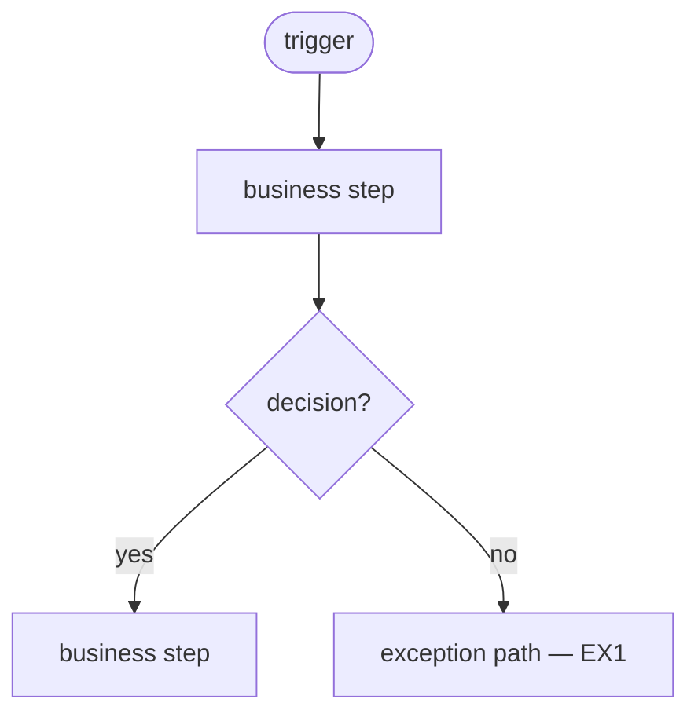

# Functional Design Document — {TASK_ID}: {TITLE}

- Status: draft | user-approved ({date})
- Mode: forward (proposed change) | as-built (existing behaviour) | change (a change already built)
- Inputs: {scope-contract.md v{n} + research-notes.md | brief: {path} | code: {repo}@{sha} | change: {repo} {base-sha}..{head-sha}}
- Audience: {business | technical} — {who: business owner, functional analysts, UAT testers, developers}
- Author: Claude, reviewed by {user}

<!-- FUNCTIONAL LEVEL ONLY (skills/func-design/SKILL.md, "Abstraction rules"):
     WHAT the system does, WHEN, under WHICH business rules, with WHAT effect
     on data — never HOW it is coded. Allowed: component names, table.column
     names that pin down business meaning, code values and their meaning,
     file names, numbered plain-language steps, decision tables, mermaid
     business flows. Not allowed: code, SQL, pseudocode, DDL, data types,
     indexes, hints, commit points, variable names, error codes.
     Mechanical floor: ses fdd-lint <file>.
     Stakeholders get a rendered view (ses fdd-view): the business
     audience drops the handoff summary, every technical:start/end region,
     and Appendix A — keep the markers around developer-only detail. -->

<!-- handoff:start -->
## Handoff summary
<!-- Written last, at this stage's gate, and updated in the same edit as any
     amendment. /tech-design reads ONLY this block unless it needs a section's
     detail. Every FR/BR/EX/TS/Q ID in the body appears here; max 40 lines —
     group IDs on one line where needed. Check: ses handoff check <file>. -->
- Contract version: {n | none (standalone or change request)}
- Purpose: {one line}
- Requirements: FR1 {…}; FR2 {…}
- Traceability: S1 → FR1, FR2 (attached mode; standalone: brief §… → FR…)
- Components: §5.1 {component} — {new | changed | context} — FR1
- Business rules: BR1 {…}; BR2 {…}
- Data: {entity — read | create | update, one line each} (§7)
- Interfaces: {direction — counterpart — content} (§8)
- Exceptions: EX1 {…}
- Scenarios: TS1 → FR1 (A1)
- Open questions: Q1 {…} | none
<!-- handoff:end -->

## 1. Purpose and business context

{The business problem, who benefits, and what changes for them — two
paragraphs at most, readable by someone who has not seen the brief.}

Business terms relied on (see `<work-repo>/.domain-glossary.md`):
{purchase order, approved, …} — the glossary entry is authoritative; this
document does not re-define terms.

## 2. Scope

### 2.1 Functional requirements

<!-- WHAT the system must do, one testable statement per row. Attached mode:
     every in-scope S# of the contract is the source of at least one FR.
     Standalone forward: cite the brief section. As-built: cite Appendix A. -->
| # | Requirement (what the system must do) | Source |
|---|---|---|
| FR1 | {Send every approved purchase order to its vendor once, on the day it is approved} | {S1} |

### 2.2 Out of scope

{Exclusions a reader might otherwise expect here — the contract's N# items in
attached mode. "None" stated explicitly.}

## 3. Actors, triggers and schedule

| Actor / trigger | Type | When / frequency | Initiates |
|---|---|---|---|
| {Nightly batch schedule} | {scheduler} | {daily 02:00, after the receipts load} | {§5.1} |
| {Buyer} | {user} | {on demand} | {§5.2} |

## 4. Functional overview

### Process flow

<!-- Business-level: nodes are business actions and decisions ("Select
     approved orders", "Vendor accepts EDI?"), not code units. Group by actor
     or system where that helps. As-built: must match the traced flow;
     forward: built from the research call graph plus the proposed change. -->

{One paragraph walking the diagram.}

### Before and after this change

<!-- Forward and change modes — the stakeholders' main view of what the
     change does; change mode fills both columns from the code (before = base
     commit, after = head commit). As-built mode: delete this subsection. -->
| Aspect | Before | After this change |
|---|---|---|
| {how orders reach vendors} | {…} | {…} |

## 5. Component functional design

<!-- One subsection per component the function involves (package, procedure,
     script, program, job). Logic is numbered plain-language steps: each step
     names the data it reads or changes (table.column, with the code value and
     its meaning) and the rule it applies (BR#), never loops, cursors, SQL, or
     variables. A 400-line procedure becomes 5–10 steps. Litmus test: two
     developers could implement these steps differently and both satisfy them.
     Mark components shown only for context as "context — unchanged"; in
     change mode, mark each new or changed step "(new)" / "(changed)". -->

### 5.1 {Component name} — {new | changed | context — unchanged}

- Purpose: {one sentence}
- Invoked by / when: {actor or caller from §3}
<!-- technical:start -->
- Inputs:

  | Input | Business meaning | Mandatory | Valid values / default |
  |---|---|---|---|
  | {run date} | {the business day being processed} | {no} | {defaults to today} |

<!-- technical:end -->
- Processing logic:
  1. {Identify the purchase orders to send: approved (`ORDHEAD.STATUS` = 'A')
     and not yet sent to the vendor (`ORDHEAD.EDI_SENT_IND` = 'N').}
  2. {Check each order against BR1; an order that fails is reported (EX1) and
     skipped, the rest continue.}
  3. {(new) Write the accepted orders to the vendor file (§8) and mark each
     as sent (`ORDHEAD.EDI_SENT_IND` = 'Y').}
- Outputs and effects: {records created or updated (table.column → new value
  and what it means), files produced, notifications sent}
- Exceptions: {EX1, …}
- Requirements met: {FR1, …}

### 5.2 {Component name}

## 6. Business rules and validations

<!-- Each rule stated once, here, and referenced by ID from §5 — never
     restated elsewhere in different words. Multi-condition rules get a
     decision table below. -->
| # | Rule | Applies to | When violated |
|---|---|---|---|
| BR1 | {An order is sent only if its vendor is EDI-enabled} | {§5.1 step 2} | {order skipped, reported as EX1} |

Decision table — {rule ID}:

| {Condition A} | {Condition B} | Outcome |
|---|---|---|
| {yes} | {yes} | {…} |

## 7. Data

<!-- The business view of the data the function reads or changes and what it
     MEANS. A column appears only when it carries meaning a reader needs. No
     DDL, data types, lengths as types, indexes, or storage — a business limit
     is stated in words ("up to 30 characters"). -->

### 7.1 Data elements

| Entity (table / file / message) | Attribute | Business meaning | Usage | New / existing |
|---|---|---|---|---|
| {ORDHEAD} | {EDI_SENT_IND} | {whether the order has been sent to the vendor} | {read, update} | {existing} |

### 7.2 Status and code values

| Attribute | Value | Meaning | Set by |
|---|---|---|---|
| {ORDHEAD.STATUS} | {A} | {approved} | {buyer approval, outside this function} |

## 8. Interfaces

| Direction | Counterpart | What is exchanged (business content) | File / message | Frequency |
|---|---|---|---|---|
| {outbound} | {vendor EDI gateway} | {approved order lines} | {PO_{yyyymmdd}.dat} | {daily} |

{Field-level content, when the audience needs it: field → business meaning →
source attribute. A layout with positions and types is the counterpart's
contract — cite it rather than restate it.}

## 9. Exceptions and error handling

| # | Situation | System behaviour | Who is informed, how | Business recovery |
|---|---|---|---|---|
| EX1 | {vendor not EDI-enabled} | {order skipped, run continues} | {buyer, exception report} | {enable the vendor or send manually; the next run picks the order up} |

## 10. Reports, screens and notifications

{What users see or receive — or "None", stated explicitly.}

## 11. Security and access

{Who may run, see, or approve what; segregation of duties; sensitive data
handled — in business roles, not grants.}

## 12. Operational expectations

<!-- Business view, one line each; "None" stated, not implied. -->
- Volumes: {…}
- Timing window / service level: {…}
- Rerun behaviour: {what a rerun does to records already processed}
- Audit and retention: {…}

## 13. Dependencies and open questions

Dependencies: {other changes, data, or teams this design relies on — or "None".}

| # | Question | Owner | Status |
|---|---|---|---|
| Q1 | {…} | {…} | {open | answered: … | deferred by {user}, {date}: …} |

## 14. Functional test scenarios

<!-- Business scenarios a UAT tester can run. Every FR# appears at least once;
     attached mode: every acceptance criterion A# of the contract too. -->
| # | Scenario | Given | When | Then | Covers |
|---|---|---|---|---|---|
| TS1 | {approved order, EDI vendor} | {…} | {nightly run} | {order in the file, marked sent} | {FR1, A1} |

## 15. Sign-off

| Role | Name | Date | Decision |
|---|---|---|---|

<!-- technical:start -->
## Appendix A. Source references

<!-- The fact table: every statement about EXISTING behaviour (all of an
     as-built or change FDD) → its source. Change mode cites the head commit
     for "after" claims and the base commit for "before" claims. The
     doc-fact-checker verifies each row; a claim about existing behaviour
     with no row is a finding. Proposed behaviour traces to §2.1 instead.
     Dropped from the business view. -->
| Section | Claim | Source |
|---|---|---|
| {§5.1 step 1} | {orders are selected by status and sent indicator} | {repo:path:line} |
<!-- technical:end -->
